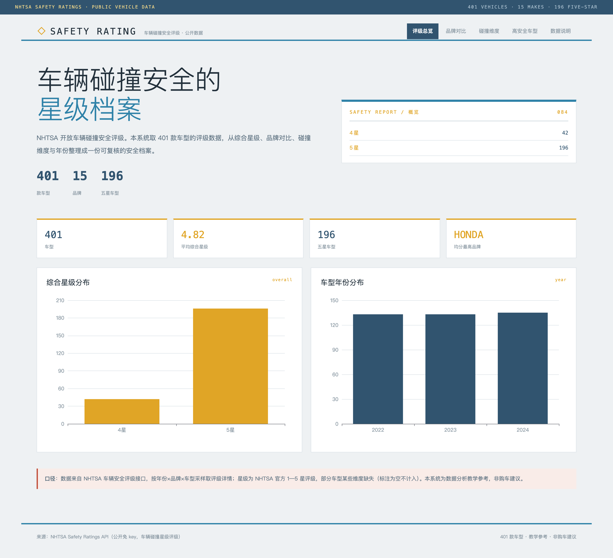
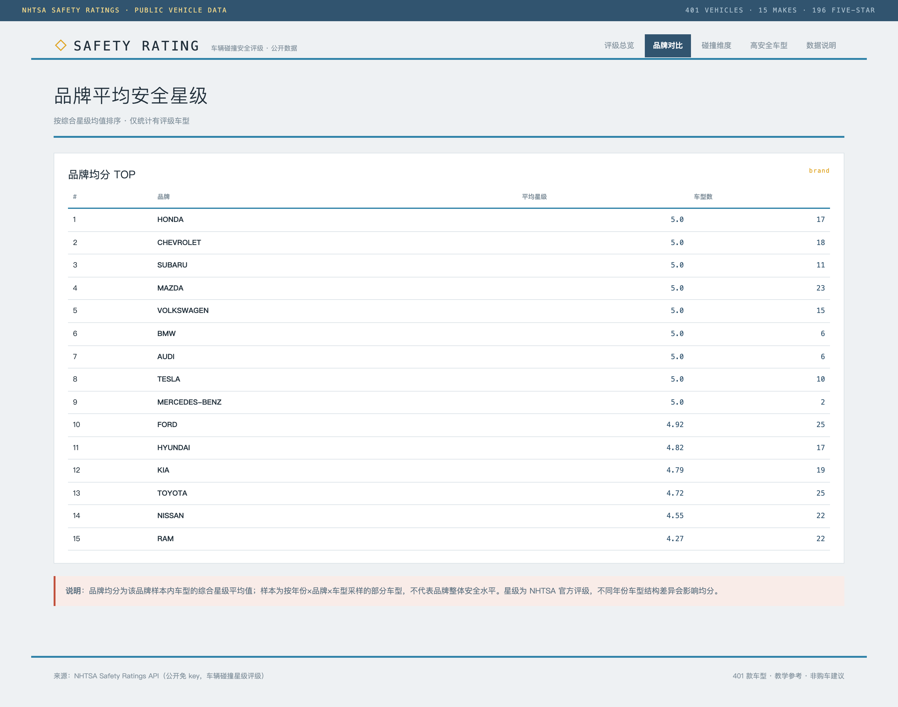
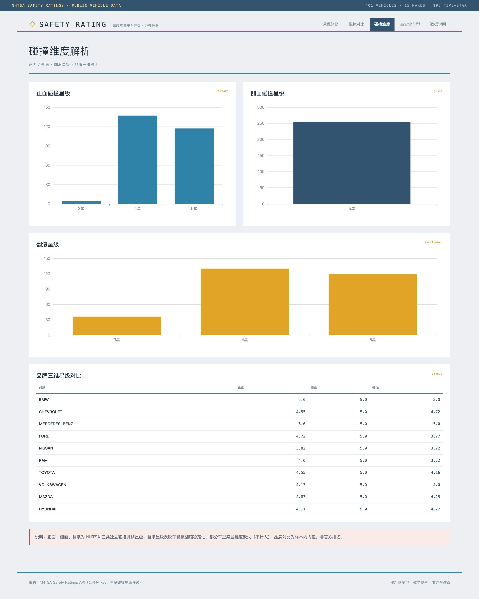
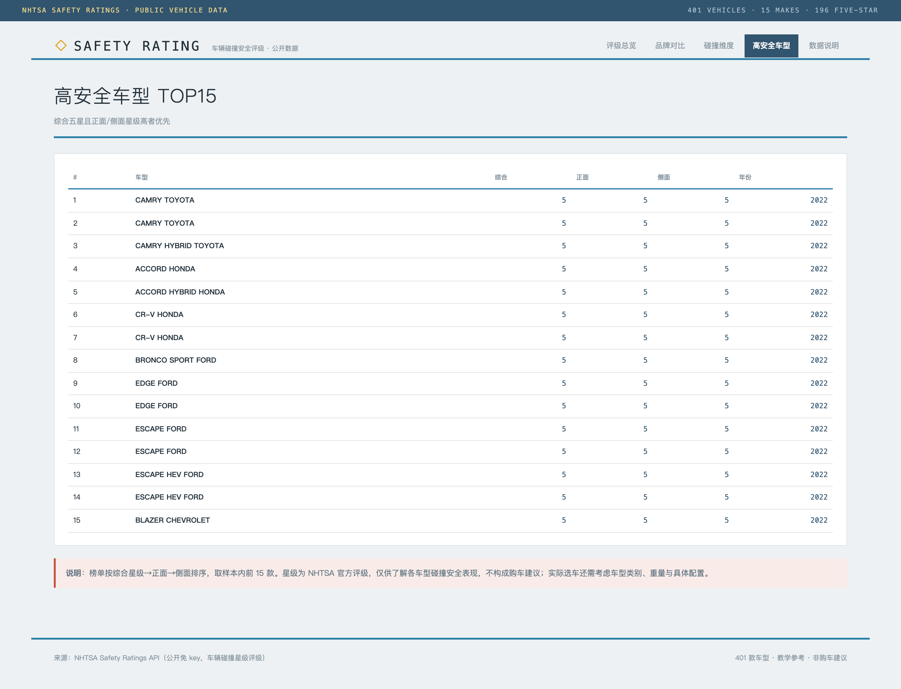
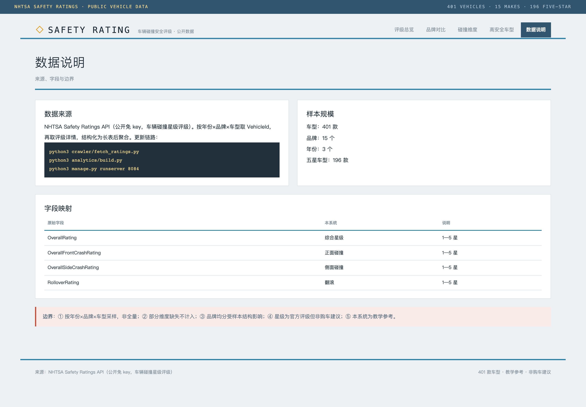

# 084 基于NHTSA公开数据的车辆碰撞安全评级分析系统-设计展示

> **代码有偿获取 可接受定制 微信联系方式: csbysj2020 或 ACE2487，备注(BS)**

> **完整源码与全套文档 · 在线自助获取 >>> [https://mbd.pub/o/bread/YZaWmJtqaw==](https://mbd.pub/o/bread/YZaWmJtqaw==)**

> **成品页（功能介绍 / 更多选题）>>> [https://bishe.suilang.net/products/safety-rating](https://bishe.suilang.net/products/safety-rating)**

> 

> 

## 视频

> **点击查看 >>> [https://www.bilibili.com/video/BV1eqyazVEoV/](https://www.bilibili.com/video/BV1eqyazVEoV/)**

## 项目简介

安全检测台风格（冷灰蓝、警示黄、星级金、检测报告卡），区别于航空导航图/古籍书页/博物图鉴。采集 NHTSA 公开车辆碰撞评级 401 款车型（15 品牌、196 五星），从综合星级、品牌、碰撞维度与高安全车型四维分析。Django + ECharts（本地化离线可用），5 个页面。多级采样与维度缺失口径如实标注，非购车建议。

车辆碰撞安全评级是观察汽车安全性能的数据窗口。

本项目设计并实现了一套基于 NHTSA 公开数据的车辆安全评级分析系统：通过多级接口按年份×品牌×车型获取 401 款车型的碰撞评级，结构化后从综合星级、品牌对比、碰撞维度与高安全车型四个维度聚合分析。

系统采用 Django + ECharts 与安全检测台式界面（冷灰蓝、警示黄、星级金、检测报告卡），实现评级总览、品牌对比、碰撞维度、高安全车型、数据说明 5 个页面。

本仓库为**设计展示**：包含项目说明、技术架构、实验结果与运行截图；完整源码、任务书、开题报告、毕业论文与使用说明可通过上方链接自助获取，成品页可查看更多选题，也可联系微信咨询定制。

## 功能特性

1. 差异化视觉：安全检测台（冷灰蓝/警示黄/星级金/报告卡），非看板/画廊/航空图

2. 真实采集：NHTSA Safety Ratings API 公开免 key，401 款车型

3. 多级取数：年份×品牌×车型→VehicleId→评级详情

4. 综合星级分布：平均 4.82 星，五星车型 196 款

5. 品牌对比：各品牌平均星级 TOP

6. 碰撞维度：正面/侧面/翻滚星级与品牌三维对比

7. 技术栈差异化：Django + ECharts（本地化）

8. 合规边界：采样非全量、维度缺失、非购车建议

## 技术架构

| 项目 | 说明 |
| --- | --- |
| 编程语言 | Python 3.8+ |
| Web 框架 | Django 4.2 |
| 图表 | ECharts（本地化离线可用） |
| 数据源 | NHTSA Safety Ratings（公开免 key） |
| 样本规模 | 401 车型 / 15 品牌 |
| 运行端口 | http://127.0.0.1:8084 |
| 说明 | 数据直读 analysis JSON，无需数据库 |

## 目录结构

以下为完整交付版的结构（本仓库仅作设计展示）：

```
safety-rating/
├── analytics/
│   └── build.py
├── crawler/
│   └── fetch_ratings.py
├── data/
│   ├── analysis/
│   │   ├── brands.json
│   │   ├── cross.json
│   │   ├── front.json
│   │   ├── overall.json
│   │   ├── rollover.json
│   │   ├── side.json
│   │   ├── top.json
│   │   └── years.json
│   ├── processed/
│   │   └── ratings.csv
│   └── stats.json
├── ratingapp/
│   ├── __init__.py
│   └── app.py
├── ratingproj/
│   ├── __init__.py
│   ├── settings.py
│   ├── urls.py
│   └── wsgi.py
├── static/
│   ├── css/
│   │   └── style.css
│   └── vendor/
│       └── echarts.min.js
├── templates/
│   ├── about.html
│   ├── base.html
│   ├── brands.html
│   ├── crash.html
│   ├── overview.html
│   └── top.html
├── 任务书/
│   └── 毕业设计任务书.docx
├── 开题报告/
│   └── 毕业设计开题报告.docx
├── 最终论文/
└── …
```

## 数据与实验结论

- 实验显示样本覆盖 15 个品牌，平均综合星级 4.82，五星车型 196 款。
- 真实采集：NHTSA Safety Ratings API 公开免 key，401 款车型
- 综合星级分布：平均 4.82 星，五星车型 196 款

## 交付内容

1. 完整源码（Django 应用 + 采集器 + 分析引擎 + 5 页面）
2. 真实数据（ratings.csv + analysis JSON）
3. 任务书与开题报告（Word）
4. 毕业论文（Word 七章制）
5. 二次开发说明（Word+md）
6. 5 张截图 + 封面 + 演示视频

## 常见问题

**星级代表绝对安全吗？**

不代表，是 NHTSA 官方分级，不同类别车型不宜直接比较。

**为什么有些维度缺失？**

部分车型某些测试未评级，系统不计入该维度。

**品牌均分是官方排名吗？**

不是，是样本内均值，受车型结构影响。

**图表能离线用吗？**

能，echarts.min.js 已本地化到 static/vendor/。

## 截图






